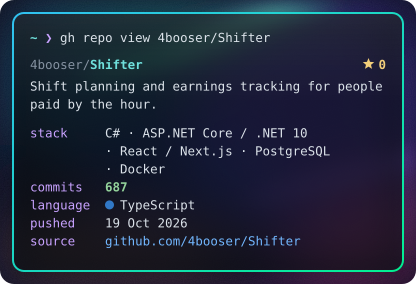
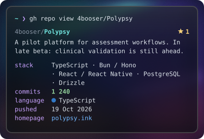
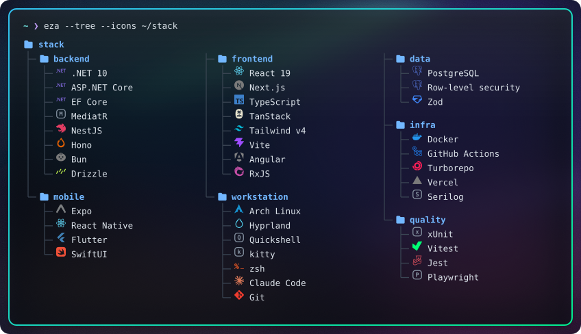

<p align="center">
  
</p>

<p align="center">
  <a href="#-whoami">whoami</a> ·
  <a href="#-btop">stats</a> ·
  <a href="#-ls-projects">projects</a> ·
  <a href="#-eza---tree-stack">stack</a> ·
  <a href="#-cat-engineeringnotes">notes</a> ·
  <a href="#-connect">connect</a>
</p>

### `$ whoami`

```ini
name      = Alex / 4booser
location  = Kyiv, Ukraine
focus     = backend engineering + full-stack applications
building  = Shifter, Polypsy, and the tools around them
interests = API design, authentication, Linux, debugging
approach  = follow the request; understand the failure
offscreen = basketball, music, making Linux feel like home
```

I build applications from the API and database up to the interface. I like understanding what happens between a click, a request, and a saved record, especially when one of those steps goes wrong.

### `$ btop`



<details>
<summary><code>cat /var/log/github.summary</code></summary>

| Metric | Value |
| :-- | --: |
| Contributions, last 365 days | 3,343 |
| Active days, last 365 days | 110 |
| Current streak, days | 34 |
| Longest streak, days | 34 |
| Busiest day | 247 on 19 Oct 2026 |
| Commit contributions | 2,622 |
| Pull requests (merged) | 25 (22) |
| Issues | 207 |
| Public repositories, own | 3 |

| Language | Share of code |
| :-- | --: |
| TypeScript | 86.6% |
| C# | 7.2% |
| HTML | 2.5% |
| JavaScript | 2.2% |
| Shell | 0.6% |
| CSS | 0.5% |
| Swift | 0.2% |
| PLpgSQL | 0.2% |

Snapshot 19 Oct 2026, 01:25 Kyiv time. The calendar is GitHub's own and includes
private activity the profile shows; languages, repositories and stars cover public, own, non-fork repositories only.

</details>

### `$ ls ~/projects`

<p align="center">
  <a href="https://github.com/4booser/Shifter"></a>
  <a href="https://github.com/4booser/Polypsy"></a>
</p>

**[Shifter](https://github.com/4booser/Shifter)**

A calendar, overtime calculations, tips, deductions, and a clear picture of what a working day earns.

<details>
<summary><code>less projects/shifter.notes</code></summary>

- Earnings rules live on the server, so the client displays the same calculation everywhere.
- Authentication uses rotating refresh tokens with reuse detection.
- Database changes have tests for unsafe migration operations and incorrect defaults.
- The repository includes application tests, CI, and a container deployment workflow.

[Source](https://github.com/4booser/Shifter) · [Architecture & setup](https://github.com/4booser/Shifter#readme)

</details>

**[Polypsy](https://github.com/4booser/Polypsy)**

Questionnaires, scoring, appointments, role-based workspaces, and a shared web/mobile core. Currently in late beta; clinical validation and clinical use are still ahead.

<details>
<summary><code>less projects/polypsy.notes</code></summary>

- Shared types, validation, and scoring logic connect the API, web, and mobile clients.
- PostgreSQL row-level security supports application access controls.
- Audit trails, revision checks, and automated tests cover sensitive workflows.
- Deployment and backup/restore tooling live alongside the application code.

[Source](https://github.com/4booser/Polypsy) · [Architecture](https://github.com/4booser/Polypsy/blob/main/docs/ARCHITECTURE.md)

</details>

**[This profile](https://github.com/4booser/4booser/tree/main/scripts)**

A dependency-free Node script reads the GitHub API and draws every image on this page.
GitHub Actions redraws it every six hours.

### `$ eza --tree ~/stack`



### `$ cat engineering.notes`

- Trace the request through the whole system before choosing where to fix it.
- Keep business rules in one place and make important assumptions testable.
- Treat authentication, migrations, and deployment as part of the product.
- Understand the trade-off well enough to explain it in plain language.

<details>
<summary><code>git log --public</code></summary>

| Repository | Last push, Kyiv time |
| :-- | :-- |
| [Polypsy](https://github.com/4booser/Polypsy) | 19 Oct 2026, 13:36 |
| [Shifter](https://github.com/4booser/Shifter) | 19 Oct 2026, 04:48 |

[Public pull requests](https://github.com/search?q=author%3A4booser+is%3Apr&type=pullrequests) ·
[All public repositories](https://github.com/4booser?tab=repositories)

</details>

### `$ connect`

<p>
  <a href="mailto:4booser@gmail.com"></a>
  <a href="https://t.me/abooser"></a>
  <a href="https://linkedin.com/in/oleksii-chepurniak"></a>
</p>

```console
4booser@github:~$ next
Keep building. Keep asking why.
```

<sub>Every image here is an SVG drawn from the GitHub API by <code>scripts/build.mjs</code>. Last build: 19 Oct 2026, 01:25 Kyiv time.</sub>
