<picture>
  <source media="(max-width: 600px)" srcset="assets/boot-mobile.svg">
  
</picture>

<p align="center">
  <a href="#-whoami">whoami</a> ·
  <a href="#-stats---window365d">stats</a> ·
  <a href="#-ls-projects">projects</a> ·
  <a href="#-cat-stackconf">stack</a> ·
  <a href="#-connect">connect</a>
</p>

### `$ whoami`

```ini
name       = Alex / 4booser
location   = Kyiv, Ukraine
focus      = backend engineering + full-stack applications
building   = Shifter, Polypsy, and the tools around them
approach   = follow the request; understand the failure
offscreen  = basketball, music, making Linux feel like home
```

I build applications from the API and database up to the interface.
I like understanding what happens between a click, a request, and a saved record —
especially when one of those steps goes wrong.

### `$ stats --window=365d`

<picture>
  <source media="(max-width: 600px)" srcset="assets/telemetry-mobile.svg">
  
</picture>

<details>
<summary><code>cat /var/log/github.summary</code> — text output & metric definitions</summary>

<!-- TELEMETRY:START -->
Snapshot: **2026-10-18 18:52 UTC**. Window: **2025-10-19 → 2026-10-18**.

| Metric | Value |
| :-- | --: |
| Contributions / 365 days | 2,901 |
| Active days / 365 days | 109 |
| Current streak / days | 33 |
| Longest streak / days within window | 33 |
| Contributions / 30 days | 1,246 |
| Active days / 30 days | 30 |
| Commit contributions | 2,184 |
| Pull requests | 16 |
| Issues | 207 |
| Code reviews | 4 |
| Public repositories / including forks | 4 |
| Stars / public owned non-fork repos | 1 |
| Followers | 2 |

GitHub member since **2023-07-08**.

| Language | Code bytes |
| :-- | --: |
| TypeScript | 19,669,867 |
| C# | 2,003,804 |
| JavaScript | 611,458 |
| Shell | 178,902 |
| CSS | 155,143 |
| Swift | 56,419 |
| PLpgSQL | 53,968 |
| Dockerfile | 13,578 |
| Batchfile | 9,306 |
| Ruby | 1,369 |
| HTML | 990 |
<!-- TELEMETRY:END -->

An **active day** has at least one contribution recorded by GitHub. It is not a
measurement of working hours. The current streak includes yesterday if today is
still empty; the longest streak is measured inside the displayed 365-day window.
Calendar dates are used as returned by GitHub, with the snapshot ending on the UTC date.
The contribution calendar can include anonymous private activity if it is visible
on the profile; the activity breakdown covers contributions accessible to the token.
Repository names, stars, and language data are taken only from public repositories.

[Snapshot data](data/profile.json) · [How the generator works](docs/telemetry.md)

</details>

### `$ ls ~/projects`

**[01 / Shifter](https://github.com/4booser/Shifter)**

Shift planning and earnings tracking for people paid by the hour.
A calendar, overtime calculations, tips, deductions, and a clear picture of what a working day earns.

`C#` `ASP.NET Core / .NET 10` `React / Next.js` `PostgreSQL` `Docker`

<details>
<summary><code>less projects/shifter.notes</code></summary>

- Earnings rules live on the server, so the client displays the same calculation everywhere.
- Authentication uses rotating refresh tokens with reuse detection.
- Database changes have tests for unsafe migration operations and incorrect defaults.
- The repository includes application tests, CI, and a container deployment workflow.

[Source](https://github.com/4booser/Shifter) · [Architecture & setup](https://github.com/4booser/Shifter#readme)

</details>

**[02 / Polypsy](https://github.com/4booser/Polypsy)**

A pilot platform for assessment workflows: questionnaires, scoring, appointments,
role-based workspaces, and a shared web/mobile core. Currently in late beta;
clinical validation and clinical use are still ahead.

`TypeScript` `Bun / Hono` `React / React Native` `PostgreSQL` `Drizzle`

<details>
<summary><code>less projects/polypsy.notes</code></summary>

- Shared types, validation, and scoring logic connect the API, web, and mobile clients.
- PostgreSQL row-level security supports application access controls.
- Audit trails, revision checks, and automated tests cover sensitive workflows.
- Deployment and backup/restore tooling live alongside the application code.

[Source](https://github.com/4booser/Polypsy) · [Architecture](https://github.com/4booser/Polypsy/blob/main/docs/ARCHITECTURE.md)

</details>

**[03 / This profile](https://github.com/4booser/4booser/tree/main/profile)**

A dependency-free C# tool that reads GitHub data and renders this terminal's SVG
telemetry. Includes streak calculations, a contribution calendar, language statistics,
and scheduled updates through GitHub Actions.

### `$ cat stack.conf`

```toml
[backend]
primary = ["C#", "ASP.NET Core", "Entity Framework Core"]
also    = ["TypeScript", "Bun", "Hono"]

[interface]
web     = ["React", "Next.js", "Angular"]
mobile  = ["React Native", "Expo"]

[data_and_delivery]
data    = ["PostgreSQL", "Drizzle"]
ship    = ["Docker", "GitHub Actions", "Git"]

[interests]
topics  = ["API design", "authentication", "Linux", "debugging"]
```

<picture>
  <source media="(max-width: 600px)" srcset="assets/languages-mobile.svg">
  
</picture>

### `$ cat engineering.notes`

- Trace the request through the whole system before choosing where to fix it.
- Keep business rules in one place and make important assumptions testable.
- Treat authentication, migrations, and deployment as part of the product.
- Understand the trade-off well enough to explain it in plain language.

<details>
<summary><code>git log --public</code> — latest repository activity</summary>

<!-- RECENT:START -->
| Repository | Last push / UTC |
| :-- | :-- |
| [Polypsy](https://github.com/4booser/Polypsy) | 2026-10-17 18:07 |
| [Shifter](https://github.com/4booser/Shifter) | 2026-10-12 04:45 |
<!-- RECENT:END -->

[Public pull requests](https://github.com/search?q=author%3A4booser+is%3Apr&type=pullrequests) ·
[All public repositories](https://github.com/4booser?tab=repositories)

</details>

### `$ connect`

[GitHub / @4booser](https://github.com/4booser) ·
[Email / 4booser@gmail.com](mailto:4booser@gmail.com)

```console
4booser@github:~$ next
Keep building. Keep asking why.
```
